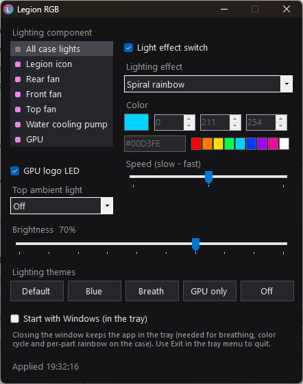
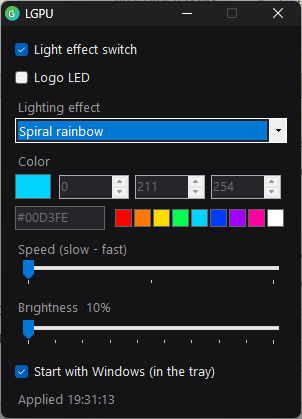

# Legion RGB

A small tray app that controls the lighting of the Lenovo Legion T7 34IAS10 with its RTX 5080, without Legion Space.
It is one exe of under 40 KB, uses the .NET Framework built into Windows and needs no admin rights.

  
  &nbsp;
  

*Left: Legion RGB (case + GPU). Right: LGPU (GPU only).*

## Download

Prebuilt `LegionRgb.exe` and `LGPU.exe` are attached to the [Releases](../../releases). Or build them yourself with `build.ps1` (output goes to `bin\`).

The `openrgb\` folder holds a work-in-progress OpenRGB controller for the GPU light chip.

## Run

- Start `bin\LegionRgb.exe`. Closing the window keeps it in the tray. Use **Exit** in the tray menu to quit.
- Tick **Start with Windows** to launch it in the tray at sign-in.
- Run `build.ps1` to rebuild both apps after changing the sources in `src\` (shared code), `src\lgpu\` (LGPU window).

## LGPU (GPU only)

LGPU is for the Lenovo GeForce RTX 5080 OEM card when it's used on its own, in a custom PC build without the other Legion parts and without Legion Space or any other Lenovo software.
It talks only to the card's light chip, through the NVIDIA driver, so it doesn't need the Legion case, its USB lighting controller or Lenovo's services.

`bin\LGPU.exe` is a smaller version (under 30 KB) with only the GPU controls: light switch, effect, color, speed, brightness and logo LED.
It keeps its own settings in `%APPDATA%\LGPU` and takes the GPU settings from Legion RGB on its first start.
Run either LGPU or Legion RGB, not both: each one re-applies its own GPU settings.

## What it controls

| Part | Effects |
|---|---|
| Legion icon, rear fan, front fan, top fan, water cooling pump | Always (any color), Breathing, Spiral rainbow, Color cycle, off |
| GPU light strip | Always (any color), Blinking, Spiral rainbow, off |
| GPU logo LED | on / off |
| Top ambient light (white, inside the case) | Off (fades out), On, Breathing, Blinking |
| Brightness | 10–100 % for everything (the hardware has 10 levels) |

The **Default**, **Blue**, **Breath**, **GPU only** and **Off** themes match the ones in Legion Space.

- When all case parts are set to *Spiral rainbow*, the case controller's own firmware runs the rainbow (exactly like Legion Space's Default theme), so it keeps going even with the app closed.
- Static colors stay on the hardware after the app exits. Breathing, Color cycle and per-part rainbow on the case are animated by the app, so they need it running in the tray.
- The GPU effects all run on the card's own light chip.

## Living with Legion Space

Lenovo's background service (SmartEngine, installed with Legion Space) re-applies its own lighting theme at boot and after sleep.
The app re-applies yours a few seconds later (at start, 10 s and 45 s after start, after resume and after unlocking). The tray menu has **Re-apply lighting** for anything else.
You can quit the Legion Space window and turn off its autostart. If you uninstall Legion Space completely, the app keeps working.

## How it talks to the hardware

Captured from Lenovo's lighting service with `tools\LightTrace` and verified on this PC.

- **Case**: USB controller `17EF:C955`.
  - Interface 1 is a standard HID LampArray with 70 lamps: front fan 0–11, icon 12–27, top fan 28–39, rear fan 40–51, pump 52–69.
  - Interface 0, feature report `0xCC`, is Lenovo's vendor channel. The zone IDs come from the BIOS table (`root\WMI` `LENOVO_LIGHTING_INFO_LIST`).
    - `CC <zone> <mode> <speed> <level 1-10>` sets a zone's firmware effect. Zone `1F` is the fans and pump, `17` is the icon, `18` is the top ambient light.
    - Modes: 00 off, 01 on, 02 blink, 03 breathing, 09 rainbow.
    - `CC 2D FF 01/00` applies the change (0x2D is the BIOS "apply" command), with host-controlled or firmware colors.
    - `CC 45 01/00` enables or disables the controller's lighting. Changing it makes the controller restart.
  - The BIOS switches the ambient light off at boot if it's disabled there. Legion Space switches it on with every theme except Off.
- **GPU**: light chip at I2C address `0x92` on the card. It is reached through the NVIDIA driver (`NvAPI_I2CWrite`, DDC output `0x100`, port 1).
  - Register `0x15`/`0x14` is the mode: 0 off, 1 always, 3 blinking, 4 rainbow.
  - `0x17` is the brightness in %.
  - `0x18`–`0x1A` hold the RGB color.
  - `0x20`–`0x23` hold the effect timing.
  - `0x50` is the logo LED.
  - Writes are wrapped in the `0x30=B0 … 0x31=B1, 0x32=B2` handshake.
